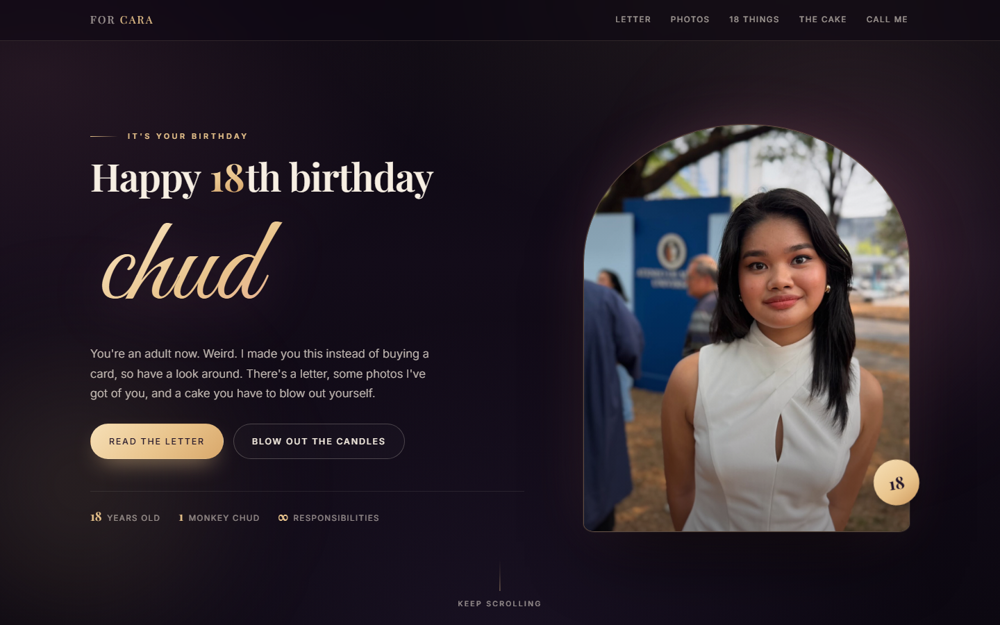

# Cara's 18th Birthday

A one-page birthday website. No build step, no dependencies, no internet needed. Everything
(fonts, photos, code) is in this folder.

**Live site:** https://j-w-i.github.io/cara-18th-birthday/

[](https://j-w-i.github.io/cara-18th-birthday/)

## How to open it

Double-click **index.html**. That's it. It opens in your browser and everything works offline.

It's also on GitHub Pages (the link above), so you can just send that link. To serve it yourself,
any static host works - this repo is set up so that pushing to `main` republishes the site.
The page is marked `noindex`, so search engines will leave it alone.

## The midnight gate

The site stays locked behind a countdown until **12:00am on her birthday, Manila time**, then
opens itself (no refresh needed) with a confetti burst.

- **Unlock time:** in `index.html`, near the top, the first `<script>` block:
  `var UNLOCK_AT = "2026-10-22T00:00:00+08:00";` — `+08:00` is Manila, so don't drop the offset.
  Change the date if her birthday is a different day.
- **Password:** in `script.js`, `var GATE_PASSWORD = "cara18";`. Type it into the box on the
  countdown screen to open the site early. Once used, that browser remembers it (localStorage),
  so it won't ask again. Case and surrounding spaces are ignored.
- **Skip it entirely:** add `?peek` to the end of the URL to see the site without the gate.
  Handy for checking your own edits.

If you'd rather not have a gate at all, set `UNLOCK_AT` to a date in the past (or delete the
`<div class="gate">` block) and the site opens straight away.

## What's on it

1. **Hero** - her name and photo, with a confetti burst on load.
2. **A letter** - the actual message, set like a real letter on paper.
3. **Photos** - a gallery of 7 photos, tap one to open it full size (arrow keys / Esc work too).
4. **18 things about you** - 18 short lines, for 18 years.
5. **The cake** - a cake with 18 candles. Tap each flame to blow it out; when all 18 are out you
   get the wish message, confetti and a "light them again" link. There's also a
   "blow them all out at once" shortcut.
6. **Call me whenever** - a live clock for her time (Manila) and yours (Sydney).
7. Footer. (There's also a small easter egg if you click the "18" in the headline a few times.)

## Things you might want to change

**Sign your name.** In `index.html`, find:

```html
<p class="sign">always, your friend</p>
```

and change it to your name, e.g. `<p class="sign">from Josh</p>`.

**Time zones.** In `script.js`, near the top of the clocks section:

```js
var MY_TZ = "Australia/Sydney";
var HER_TZ = "Asia/Manila";
```

Change `MY_TZ` to your own IANA time zone (e.g. `"Europe/London"`, `"America/Toronto"`) and the
label in `index.html` (`My time <span>· Sydney</span>`) to match.

**Photos.** They live in `assets/img/`. To swap one, replace the file (keep it under ~400KB and
around 1400px on the long side), or point the `` at a different file. There are no
visible captions - the only text attached to a photo is its `alt` attribute, which screen readers
read out, so keep that accurate.

**Wording.** All of the copy is plain HTML in `index.html`, so you can edit any of it directly.

## How it's built

- `index.html` - the page and all the text.
- `styles.css` - styling. Colours and fonts are CSS variables at the top.
- `script.js` - confetti, gallery viewer, candles, clocks, scroll reveals, easter egg.
- `assets/img/` - the 7 optimised photos (about 1.2MB total) plus `manifest.json`.
- `assets/fonts/` - self-hosted Playfair Display, Inter and Great Vibes (SIL Open Font License).
- `preview/` - screenshots of the finished page.
- `photos_raw/` - the original photos as they came out of the zip. Nothing is referenced from
  here; it's just kept so you have the originals. It's gitignored (see the note below), so it
  stays on your machine and never goes into the repo.

Note: the Instagram DM/story screenshots and the video from the zip were deliberately left out -
they had private chat content, a student ID and app UI over the top, so they didn't belong on a
page she might show people. The site only uses the 7 clean photos. For the same reason
`photos_raw/` and the original zip are in `.gitignore`: the public repo only contains the 7
curated photos.

## Publishing

This repo is set up for GitHub Pages: Settings -> Pages -> "Deploy from a branch" -> `main` / `/ (root)`.
Pushing to `main` updates the live site in about a minute. 

## Tweaking the look

At the top of `styles.css`:

```css
:root {
  --ink: #0b0710;      /* page background   */
  --gold: #e9c48c;     /* accent            */
  --rose: #e88fa8;     /* secondary accent  */
  --cream: #f7efe3;    /* headings          */
}
```

Change those and the whole page follows. Motion is dialled down automatically for anyone with
"reduce motion" turned on in their system settings.
